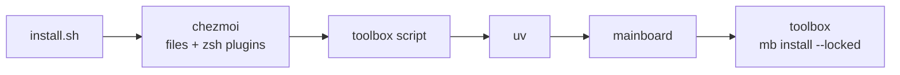

# Dotfiles

zsh, herdr, Neovim and a command-line toolbox, identical on Linux and macOS, installed by one command without sudo. [chezmoi](https://www.chezmoi.io/) places the files, and [mainboard](https://pypi.org/project/mainboard/) owns the toolbox through [`mb.toml`](mb.toml).

```sh
curl -fsSL https://raw.githubusercontent.com/Pedrexus/dotfiles/main/install.sh | sh
```

From a checkout, `sh install.sh` uses that checkout as the chezmoi source. On a machine mainboard already manages, `mb host setup <host> --dotfiles` applies the same repository, and every later `mb host sync` keeps it.

## How it fits together



chezmoi is one static binary that needs no git, so a throwaway copy goes first and the shell is configured within seconds. The toolbox script it runs is the only place that bootstraps uv and mainboard, whether the entry point is `install.sh`, `mb host setup` or `chezmoi update`, and the toolbox's own chezmoi takes over from there.

`mb.lock` is solved once for linux-64, linux-aarch64 and osx-arm64, so a host installs exactly what was tested and never solves for itself. `mb.toml` holds only floors at the newest release; `mb upgrade` in this directory raises them and re-locks. The script reruns `mb install --locked` whenever either file changes.

conda-forge ships every command-line tool at its newest release, so `[deps]` holds them; the Python tools (ipython, nvitop) are `[python.deps]`, installed from PyPI where they are released. uv is not in the lock: the script installs it first, since it installs mainboard.

## What you get

| | |
|---|---|
| shell | zsh with fzf-tab and zsh-completions as plain files; starship prompt; zoxide |
| multiplexer | herdr: it keeps its own ssh connection per saved machine (`herdr machine add gold`) and the sessions running when the client leaves; `ctrl+b q` detaches |
| editor | [LazyVim](https://www.lazyvim.org) in `~/.config/lazyvim`, launched as `lvim` and set as `$EDITOR` |
| search and files | ripgrep, ripgrep-all (`rga` through PDFs and documents), fd, fzf, bat, eza, dust, bottom |
| development | git, git-lfs, gh, lazygit, python, ipython, node, rust, tree-sitter, jaq, xh, parallel |
| documents and media | pandoc, poppler, qpdf, ghostscript, imagemagick, ffmpeg |
| mainboard | pueue, the queue a plain ssh host dispatches through |
| Linux only | zsh, for a host with neither sudo nor a system zsh, and nvitop |

The toolbox sits on `PATH` after the system's directories, so a system tool always wins and the toolbox fills the gaps. pixi keeps one home per architecture (`~/.pixi/$(uname -m)`), so an HPC home shared by x86-64 and aarch64 nodes works.

## Shells

zsh is the shell you type in. Where the login shell cannot be changed, an interactive bash on a terminal hands over to zsh, so a terminal or ssh session that starts bash still lands in zsh. `DOTFILES_BASH=1` keeps bash, and zsh's children inherit it, so a `bash` typed inside zsh stays bash. An agent running `bash -ic` is on pipes, not a terminal, and keeps its command. Every startup file sources mainboard's `~/.config/mainboard/path.sh`, so `mb` never appends a line of its own.

Agents run bash, not zsh: they write bash, and zsh aborts a command whose glob matches nothing and reads `$ref:path` as a history modifier. Claude Code is pointed at the toolbox's bash (5.2.37, conda-forge's newest, the same on every machine; macOS ships 3.2) through `CLAUDE_CODE_SHELL`, an undocumented variable it reads once at startup. Codex has no shell setting and runs the login shell, which is bash on Fedora; opencode takes a `shell` key in its own config.

The toolbox's ncurses names its terminfo directories in hex (`78/xterm-256color`) where Linux names them by letter, so it cannot read the system's definition of a terminal such as `xterm-ghostty`, and its line editor would repeat every key typed. zsh falls back to `xterm-256color` when it finds no definition.

## Day to day

| | |
|---|---|
| pull and apply | `chezmoi update` |
| raise the toolbox | `mb upgrade` here, then commit `mb.toml` and `mb.lock` |
| raise the editor | `:Lazy update` in `lvim`, then `chezmoi re-add ~/.config/lazyvim/lazy-lock.json` |
| see drift | `chezmoi status` |

## Fedora KDE

Nothing but `curl` and `tar` is needed, and no sudo. Fedora leaves sshd off, so a machine meant to be reached by `mb host setup` needs `sudo systemctl enable --now sshd` once. Two system packages complete the editor:

```sh
sudo dnf install gcc            # nvim-treesitter compiles its parsers
sudo dnf install wl-clipboard   # the Wayland clipboard; LazyVim syncs it except over ssh
```

Add `tmux` only to use `mb shell --on <host> --keep`, which wraps an allocation in that host's own `/usr/bin/tmux`. To make zsh the login shell, `sudo dnf install zsh && chsh -s /usr/bin/zsh`; the bash handover works without it.

## Notes

- macOS 14.5 or later: conda-forge's ghostscript 10.8 requires it.
- A Nerd Font in the terminal gives LazyVim its icons; over ssh that is the client's font.
- On an HPC cluster, `compilation failed` means no compiler is loaded: `module purge`, then `module load` one.
